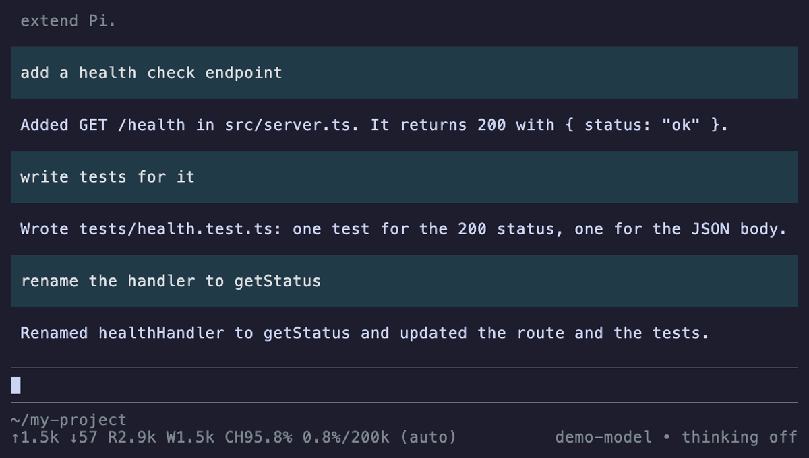

# pi-outline

[](LICENSE) [](https://github.com/earendil-works/pi)

A table of contents for your pi session. It's a side panel on the right of the transcript.

The panel lists the first line of every prompt you sent on the current session branch. Prompts are numbered, and the newest one is at the bottom. Long sessions are hard to scroll back through, and the outline lets you see what you asked and in what order without leaving the editor. It also helps you find your place before you jump with `/tree`.



- The list is rebuilt from the session, so it survives hiding the panel, `/reload` and resume.
- When you switch branches with `/tree`, the list follows the new branch.
- Lines are cut to the panel width (32 columns). The list scrolls and stays pinned to the newest prompt.
- Whether the panel is shown is saved in the session, so `/reload` and resume bring it back. A new session starts with it hidden.

## Requires

> [!NOTE]
> pi-outline needs the `left`/`right` widget placements from the `my` branch of the [msetsma/pi-my](https://github.com/msetsma/pi-my/tree/my) fork. In stock pi the panel shows up as a full-width widget above the editor, not beside the transcript.

- Fullscreen mode (`"tuiMode": "fullscreen"` in `~/.pi/agent/settings.json`). In regular mode, toggling only shows a notice.
- A terminal at least 72 columns wide (the 32-column panel plus 40). The panel hides while the terminal is narrower.
- The fork's optional `id` on `registerShortcut`, if you want to rebind `alt+o`. Stock pi ignores the id and keeps `alt+o`.

## Install

Point `packages` in `~/.pi/agent/settings.json` at a local checkout:

```json
{ "packages": ["~/dev/pi-fork/pi-outline"] }
```

Or install from git:

```bash
pi install git:github.com/msetsma/pi-outline
```

This writes `"git:github.com/msetsma/pi-outline"` to `packages`. To pin a version, add `@<tag or commit>`. Run `/reload` to pick up changes.

## Commands and keys

| Command / key | Does |
|---|---|
| `/outline` | Toggle the panel |
| `alt+o` | Toggle the panel (shortcut id `pi-outline.toggle`) |

To rebind the shortcut, add its id to `~/.pi/agent/keybindings.json`. `[]` turns it off.

```json
{ "pi-outline.toggle": ["alt+shift+o"] }
```

## Development

`npm run check` typechecks against the fork's sources. It expects the fork checked out at `../pi-my` (on its `my` branch) with `node_modules` installed.

`vhs demo/demo.tape` regenerates the demo GIF. It needs [vhs](https://github.com/charmbracelet/vhs) and the fork at `../pi-my`, and it runs offline with a fake model.

## License

MIT
